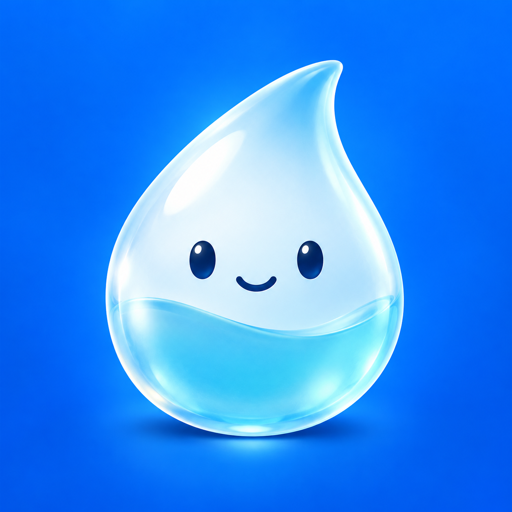

# 多喝水 · 使用帮助

给忙碌的一天，留一口水的时间。

这里提供「多喝水」iPhone 应用的提醒设置、相机动作验证和记录使用帮助。适用于 iOS 26 及更新版本。

[隐私政策](PRIVACY.md) · [联系支持](mailto:shi_rc@foxmail.com)

## 联系支持

遇到问题或有建议，可以发邮件至 **[shi_rc@foxmail.com](mailto:shi_rc@foxmail.com)**。

请附上 iPhone 型号、iOS 版本、应用版本与问题出现的步骤。无需提供密码、验证码或相机人像；截图前可先遮住私人信息。

## 开始使用

1. 使用运行 iOS 26 或更新版本的 iPhone。
2. 在设置中选择适合自己的提醒节奏。
3. 允许系统闹钟权限。默认时段为每天 09:00–21:00，可在「自定义节奏」调整。
4. 首次验证时允许相机权限，在正常光线下保持脸、持杯的手和杯子或水瓶入镜，自然举起喝一口。

| 提醒方案 | 间隔 | 每日动作次数目标 |
| --- | --- | --- |
| 轻松 | 90 分钟 | 6 次 |
| 日常 | 60 分钟 | 8 次 |
| 规律 | 30 分钟 | 12 次 |

应用记录动作通过的次数和时间，不测量实际饮水量。次数目标是习惯目标，不是适用于每个人的饮水处方。

## 常见问题

### 相机一直没有通过，怎么办？

把手机竖直放稳，改善光线，让脸、持杯的手和容器同时留在画面中。先从自然位置举起杯子或水瓶，持续喝一小口。标准模式和严格模式要求不同，严格模式还需要把容器移开嘴边并留在画面内。识别会受遮挡和角度影响，不能据此判断实际摄入水量；如仍失败，请联系支持。

### 提醒没有响，或没有再次响起？

先检查提醒开关、当前日期和提醒时段，以及 iOS 中的闹钟权限。系统声音被停止后，当前任务仍可能保留；没有新增记录不等于已经完成。1.0.0 已在实体 iPhone 上通过锁屏连续三次响铃测试，前两次点击系统“停止”后仍会再次提醒；这不代表所有状态下都能无限送达。请勿将应用用于服药或其他必须准时送达的事项。

### 为什么修改设置后没有立刻结束任务？

已有待完成任务时，新频率或暂停设置会在本次相机动作验证完成后生效。修改设置和停止系统声音都不会生成完成记录。验证页右上角可查看设置，打开时会暂停相机。

### 会保存或上传相机画面吗？

不会。视频帧只用于设备内的实时动作分析，不录制或上传。应用也不使用麦克风。设置和完成记录保存在应用本地容器中；详情见[隐私政策](PRIVACY.md)。

### 如何关闭权限或删除本地记录？

可以在 iOS 设置中管理本应用的相机和闹钟权限。当前版本没有单独删除全部记录的按钮。如需删除本地容器，可在 iPhone 储存空间中选择「删除 App」；「卸载 App」会保留数据。删除是不可恢复的操作，系统备份中已有的副本需在相应备份设置中另行管理。

### 喝水小知识能代替医生建议吗？

不能。应用是日常习惯工具，不是医疗器械，不提供诊断或治疗。饮水需求因人而异；如有疾病或医生要求限制饮水，请先按医嘱安排。健康资料来自 [NIDDK](https://www.niddk.nih.gov/health-information/urologic-diseases/kidney-stones/treatment)。

---

© 2026 RENCHUANG SHI · [联系支持](mailto:shi_rc@foxmail.com) · [隐私政策](PRIVACY.md)
